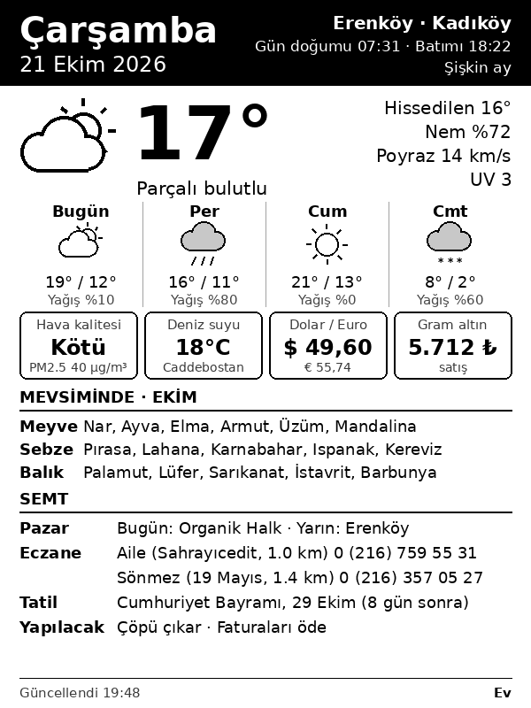

# Home Display — Kindle 4 (firmware 4.1.1) · Erenköy / Kadıköy

Kindle 4'ü (klavyesiz "Kindle 4 NT") duvara asılabilir bir ev panosuna çevirir.
**Sıfır maliyetlidir:** sunucu, abonelik ya da API anahtarı gerekmez.

```
 GitHub Actions (ücretsiz)            GitHub (ücretsiz barındırma)          Kindle 4
 her 30 dk: verileri topla,   ──▶   "display" dalı: display.png   ──▶   15 dk'da bir indir,
 600×800 PNG çiz                                                          değiştiyse ekrana bas
```

Görüntüyü GitHub Actions üretir. Herkese açık depolarda Actions dakikaları sınırsız ve ücretsizdir.
Kindle PNG'yi `raw.githubusercontent.com` adresinden indirir. Kindle 4'ün kendi `wget`'i
modern HTTPS'e bağlanamaz; bu yüzden pakete [kindle-dash](https://github.com/pascalw/kindle-dash)
projesinin K4 için derlenmiş `xh` istemcisi eklenmiştir.



## Ekranda neler var

| Bölüm | İçerik | Kaynak (hepsi ücretsiz, anahtarsız) |
|---|---|---|
| Başlık | Gün, tarih, gün doğumu/batımı, ay evresi | Open-Meteo + yerel hesap |
| Hava | Erenköy'de anlık durum, hissedilen, nem, rüzgar (poyraz/lodos…), UV, 4 günlük tahmin | [Open-Meteo](https://open-meteo.com) |
| Kutucuklar | Hava kalitesi (PM2.5), Caddebostan açığında deniz suyu sıcaklığı, dolar/euro, gram altın | Open-Meteo Air Quality + Marine, [truncgil finans](https://finans.truncgil.com) |
| Mevsiminde | O ayın meyveleri, sebzeleri, İstanbul balıkları; av yasağı (15 Nisan – 31 Ağustos) uyarısı | `server/local_data.py` |
| Semt | Bugün/yarın kurulan pazarlar (Erenköy Pazarı Perşembe, Göztepe Pazartesi, Organik Halk Pazarı Çarşamba…), sıradaki resmi tatil, takvim, yapılacaklar | Kadıköy Belediyesi listesi, [Nager.Date](https://date.nager.at) |

İstenmediği için deprem ve ezan vakti bilgisi **yoktur**.

---

## 1. Bulut tarafı (bir kez, 2 dakika)

Depo hazır. Yapmanız gereken tek şey Actions'ın çalıştığını doğrulamak:

1. GitHub'da depo → **Actions** sekmesi. "I understand my workflows, go ahead and enable them" çıkarsa onaylayın.
2. **render** iş akışı → **Run workflow**. Bir dakika içinde `display` dalı oluşur.
3. Tarayıcıda şu adresi açın, panoyu görmelisiniz:
   `https://raw.githubusercontent.com/melihgucer-art/home_display/display/display.png`

Bundan sonra görüntü her saat :07 ve :37'de kendiliğinden yenilenir. GitHub zamanlanmış işleri
yoğunlukta 5–15 dk geciktirebilir. Saat bu yüzden görüntüye konmadı; altta "Güncellendi" saati yazar.

### Kişiselleştirme (telefondan da olur)

- **Yapılacaklar:** `server/todo.txt` dosyasını GitHub uygulamasından düzenleyin. Her satır bir madde.
- **Ayarlar:** `server/config.toml`: konum, kutucuklar, yatay kullanım (`rotate = 90`).
- **Mevsim listeleri / pazarlar:** `server/local_data.py`.
- **Takvim (isteğe bağlı):** Google Takvim → Ayarlar → takvim → *iCal biçiminde gizli adres*.
  Bu adresi depoya **yazmayın** (depo herkese açık). Bunun yerine depo → Settings → Secrets and variables →
  Actions → *New repository secret* yolunu izleyin: ad `CALENDAR_ICS_URLS`, değer adres(ler) (birden fazlaysa boşlukla ayırın).

> Not: GitHub, depoda 60 gün hiç etkinlik olmazsa zamanlanmış işleri durdurur. İş akışının kendisi
> her çalıştığında `display` dalına yazdığı için bu normalde olmaz. Olursa Actions sekmesinden yeniden etkinleştirin.

---

## 2. Kindle 4'ü hazırla (firmware 4.1.1)

Önce sürümü doğrulayın: **Menu → Settings → Menu → Device Info**.

Gerekli dosyalar MobileRead'deki NiLuJe dizinindedir:
**https://www.mobileread.com/forums/showthread.php?t=225030** (Kindle 4 / "K4" bölümü).

### 2.1 Jailbreak

1. **Kindle 4 jailbreak** paketini (`kindle-k4-jailbreak-*.zip`) indirip açın.
2. Kindle'ı USB ile bağlayın. Paketteki `data.tar.gz`, `ENABLE_DIAGS` dosyasını ve
   `diagnostic_logs` klasörünü Kindle'ın kök dizinine kopyalayın.
3. **Menu → Settings → Menu → Restart**.
4. Diagnostics menüsünde: **D) Exit, Reboot or Disable Diags → R) Reboot System → Q**.
5. Açılışta jailbreak mesajı görünür. Kökteki dosyalar kendiliğinden silinir.

### 2.2 MKK + KUAL

1. **MKK (MobileRead Kindlet Kit)** paketindeki K4 dosyasını (`Update_mkk-*-k4-*.bin`) Kindle köküne
   kopyalayın → **Menu → Settings → Menu → Update Your Kindle**.
2. **KUAL** paketindeki `KUAL-KDK-1.0.azw2` dosyasını Kindle'daki `documents/` klasörüne kopyalayın.
   Kütüphanede "Kindle Launcher" olarak görünür.

### 2.3 Home Display eklentisi

1. Depo → **Releases → "Kindle eklentisi"** → `homedisplay-kindle.zip` dosyasını indirin.
   Bu paket `xh` dosyasını içerir. Depodaki `kindle/` klasöründe xh yoktur.
2. Zip'i açın, içindeki `extensions` klasörünü Kindle'ın köküne kopyalayın (var olanla birleşsin).
   Sonuç: `extensions/homedisplay/config.xml`, `extensions/homedisplay/bin/xh`.
3. Kindle'da Wi-Fi'ye bağlanın. **Kindle'ın saati doğru olmalı**, yoksa HTTPS bağlantısı kurulamaz.
4. KUAL → **Home Display → Tek seferlik yenile** ile görüntünün geldiğini kontrol edin.
5. **Home Display → Başlat**.

Başlatınca Kindle arayüzü durdurulur (çizilen görüntünün üstüne yazmasın diye) ve pano 15 dakikada
bir kontrol edilir. Görüntü değişmediyse ekran yeniden çizilmez.

**Çıkış:** Home tuşuna basın. Tepki vermezse güç düğmesini ~20 sn basılı tutun; cihaz yeniden başlar
ve normal haline döner (eklenti açılışta kendiliğinden çalışmaz).

### Kindle ayarları: `extensions/homedisplay/config.sh`

| Ayar | Varsayılan | Açıklama |
|---|---|---|
| `IMAGE_URL` | raw.githubusercontent… | Görüntünün adresi |
| `REFRESH_SECONDS` | 900 | Kontrol aralığı |
| `FULL_REFRESH_EVERY` | 6 | Kaç güncellemede bir tam yenileme (gölgeyi temizler) |
| `WAIT_MODE` | `sleep` | `sleep`: cihaz uyanık kalır (şarja takılı kullanım). `suspend`: RTC ile uyur (deneysel) |
| `NIGHT_HOURS` | `0-6` | Bu saatlerde yenileme yapılmaz |
| `WIFI_OFF_BETWEEN` | 0 | 1 yapılırsa Wi-Fi kontroller arasında kapanır |
| `LOW_BATTERY` | 15 | Pil bu yüzdenin altına inince köşede uyarı çıkar |

**Pil:** Duvarda kalıcı kullanım için USB şarja takılı tutun. Şarjsız kullanacaksanız
`WIFI_OFF_BETWEEN=1` ile birkaç gün dayanır.

---

## 3. Sorun giderme

- **Log:** Kindle'da `/tmp/homedisplay.log`.
- **"Sunucuya ulasilamadi":** Kindle saati yanlışsa HTTPS başarısız olur. Ayarlardan saati düzeltin.
  `bin/xh` dosyasının yerinde olduğunu kontrol edin.
- **Alt satırda "alınamadı: …":** O veri kaynağı o an yanıt vermemiş demektir. Pano yine çizilir.
  Ayrıntı için Actions → render → son çalıştırmanın loguna bakın.
- **Görüntü eski:** Actions sekmesinde render iş akışının çalıştığını kontrol edin.

## Alternatif: yerel sunucu

Evde sürekli açık bir makine varsa bulut yerine onu da kullanabilirsiniz:
`pip install -r server/requirements.txt && python3 server/home_display.py serve` (ya da `docker compose up -d`).
Kindle'daki `IMAGE_URL` değerini `http://<ip>:8080/display.png` yapın.

## Dosya yapısı

```
server/
  home_display.py      veri toplama + çizim (+ isteğe bağlı yerel HTTP sunucu)
  local_data.py        mevsim meyve/sebze/balık, Kadıköy semt pazarları, ay evresi
  config.toml          ayarlar (herkese açık, gizli bilgi yazmayın)
  todo.txt             yapılacaklar
.github/workflows/
  render.yml           her 30 dk panoyu üretip display dalına yazar
  kindle-package.yml   Kindle eklentisini xh ile paketleyip Releases'e koyar
kindle/extensions/homedisplay/   KUAL eklentisi
```
